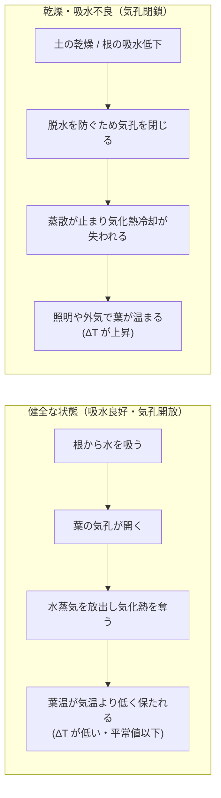
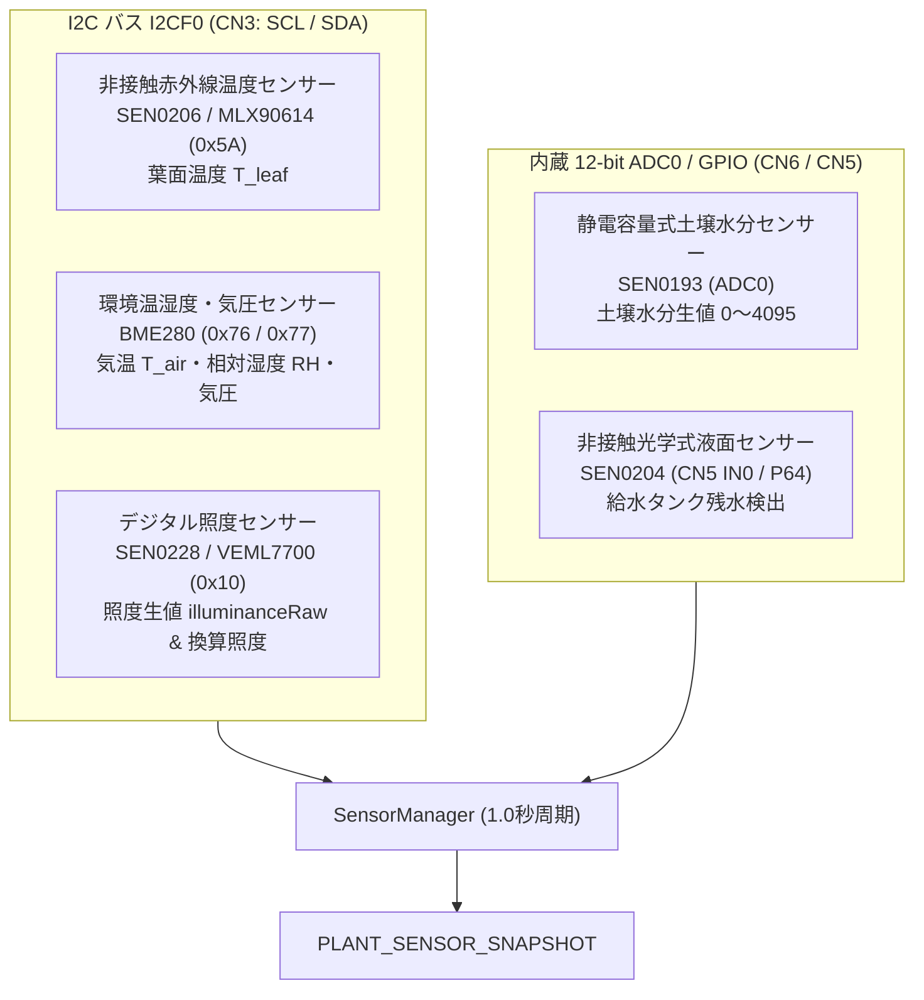
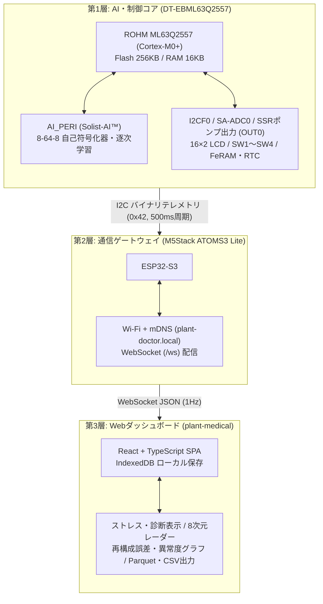

# 第1章 エッジAIと植物生体センシング技術

植物は水が足りなくなったり暑すぎたりしても、声を出して知らせられません。葉がしおれたり変色したりして人が気づいたときには、すでに根や葉の組織が傷んでいることも少なくありません。

Plant Doctor は、目に見える変化が出る前の段階で、葉の温度や土の乾き方から植物の体調を読み取り、必要に応じて自動で水やりまで行う装置です。第1章では、植物の蒸散作用を手がかりに生体状態を測る原理と、5種類のセンサーの具体的な計測処理、そしてマイコン基板1枚で判断まで完結させるエッジAI構成について解説します。

---

## 1.1 蒸散と気化熱から植物の体調を読む

植物が根から吸い上げた水を水蒸気として葉から放出する働きを**蒸散（Transpiration）**と呼びます。この蒸散が順調に行われているかどうかは、葉の温度と周囲の気温を比べることで外から非接触で確かめられます。



### 気孔の開閉と葉温の変化

葉の表面にある小さな穴（気孔）は、光合成のために二酸化炭素を取り込むと同時に、内部の水分を蒸発させています。水が液体から気体へ変わるときには周囲から気化熱（$20^\circ\text{C}$ で約 $2.45 \times 10^6\text{ J/kg}$）を奪うため、十分に水を吸って蒸散している葉は周囲の空気より冷やされます。

反対に、土が乾いてきたり根が傷んで水を吸えなくなったりすると、植物はしおれるのを防ぐために気孔を閉じます。すると気化熱による冷却が止まり、照明や日射の熱を受けて葉の温度が上がります。

### 葉温と気温の差（$\Delta T$）を使う理由

葉の温度（$T_{\text{leaf}}$）だけを測っても、部屋自体が涼しいのか、蒸散によって葉が冷えているのかは区別できません。そこで Plant Doctor では、葉面温度と周囲の気温（$T_{\text{air}}$）の差である**葉気温差 $\Delta T$** を主要な指標として使います。

$$\Delta T = T_{\text{leaf}} - T_{\text{air}}$$

ファームウェア（`PlantFeature.c`）では、葉温と気温をそれぞれ $1/100^\circ\text{C}$（centi-℃）単位の整数で保持し、両方のセンサー値が有効なときに差分 `leafAirTemperatureDelta` を計算します。

- **平常時の目安**: 設定ファイル（`PlantDoctorConfig.h`）では、平常時の基準値 `PLANT_DOCTOR_STRESS_BASELINE_TEMP_DELTA` を $+0.80^\circ\text{C}$（`80`）としています。照明の熱を受けながらも蒸散が働いていれば、$\Delta T$ はマイナスからこの基準値以下に収まります。実機ログ（9月21日〜22日の記録）でも、給水が行われたあとには葉気温差が下がり、蒸散が回復する様子が記録されています。
- **熱ストレス・吸水不良の目安**: $\Delta T$ が $+2.00^\circ\text{C}$（`200`）以上で、かつ葉温の上昇速度が $+0.50^\circ\text{C}/\text{h}$（`50`）以上のときは熱ストレス（`PLANT_STATUS_HEAT_STRESS`）と判定します。また、土が湿っている（$400\text{‰}$ 以上）のに $\Delta T$ が $+1.50^\circ\text{C}$（`150`）以上で、給水しても葉が冷えない場合は、根の吸水不良（`PLANT_STATUS_ROOT_UPTAKE`）を疑います。

---

## 1.2 5種類のセンサーとファームウェアの計測処理

DT-EBML63Q2557 ボードには、植物と周囲の環境を測る5種類のセンサーを接続しています。`SensorManager` が1秒（100 ticks）ごとにすべてのセンサーを読み取り、最新のスナップショット `PLANT_SENSOR_SNAPSHOT` を更新します。



### 1. 非接触赤外線温度センサー（SEN0206 / MLX90614）

葉から出る赤外線をサーモパイル素子で受け取り、葉を傷つけずに表面温度を測ります（I2C アドレス `0x5A`）。
- `LeafTemperatureSensor.c` でオブジェクト温度レジスタを読み出し、PEC（CRC-8）とエラービットを検証したうえで $1/100^\circ\text{C}$ 単位の整数 `leafTemperatureCentiC` に変換します。
- 妥当性判定（`SensorPlausibility.c`）では、$-70.00^\circ\text{C} \sim +120.00^\circ\text{C}$ の範囲外や、気温との差 $|\Delta T|$ が $20.00^\circ\text{C}$ を超える状態が5回続いた場合にセンサー異常と判定します。

### 2. 環境温湿度・気圧センサー（BME280）

鉢のまわりの気温、相対湿度、気圧を測ります（I2C アドレス `0x76` または `0x77` を自動検出）。
- `EnvironmentSensor.c` は初期化時にチップ ID（`0x60`）を確認し、素子固有のトリミング補正値（`dig_T1`〜`T3`、`dig_P1`〜`P9`、`dig_H1`〜`H6`）を読み出します。浮動小数点を使わずに 32 ビット整数演算で温度補正を行い、気温 `airTemperatureCentiC`（$1/100^\circ\text{C}$ 単位）、相対湿度 `relativeHumidityCentiPercent`（$1/100\%$ 単位、$0 \sim 10000$）、気圧 `barometricPressurePa`（Pa 単位）を算出します。
- 動作中に通信が切れても、次の周期で自動的に再プローブして復帰できる作りになっています。

### 3. デジタル照度センサー（SEN0228 / VEML7700）と「生値」の扱い

植物に当たる光の強さを測ります（I2C アドレス `0x10`）。ここで特に注意したいのが、**ファームウェア内部とテレメトリにおける「生値（Raw）」と「ルクス（lx）換算値」の使い分け**です。

```c
/* sensors/EnvironmentSensor.c: SEN0228 (VEML7700) の読み取りと換算 */
sample->illuminanceRaw = (uint16_t)response[0] | ((uint16_t)response[1] << 8U);
sample->illuminanceCentiLux = (((uint32_t)sample->illuminanceRaw * 576UL) + 50UL) / 100UL;
```

- **換算式**: レジスタ `0x04` から読み出した 16 ビットのカウント値が `illuminanceRaw`（生値）です。ファームウェアでは生値に $5.76$ を掛けて $1/100\text{ lx}$ 単位の `illuminanceCentiLux` を求めており、**生値 1 は約 $0.0576\text{ lx}$** に相当します。実機ログで照明がついている時間帯の生値は約 `1350` であり、ルクスに換算すると約 $78\text{ lx}$ です。
- **どこでどちらを使うか**:
  - **ローカル LCD（ページ 2）**: `illuminanceCentiLux` を使い、ルクス換算値（`LUX:77.76` など）を表示します。
  - **特徴量・AI 入力・日照不足判定・I2C テレメトリ**: すべて**センサーの生値 `illuminanceRaw` をそのまま使います**。具体的には、Solist-AI への第6入力 $x_5$ は生値 $0 \sim 6000$ を $0 \sim 256$ に正規化し、24時間の積算照度 `illuminanceAccumulated` も1分ごとに生値を足し上げます（日照不足のしきい値 `144000` は、生値 100 × 60分 × 24時間）。また、ATOMS3 Lite へ送るテレメトリパケットの `pkt.illuminanceRaw` も生値です（ダッシュボード側ではこの生値をそのまま表示しています）。

### 4. 静電容量式土壌水分センサー（SEN0193）と2点校正

土壌の誘電率変化を電圧として出力する腐食しにくいセンサーで、ML63Q2557 内蔵の 12 ビット逐次比較型 ADC（`SA-ADC0`）で読み取ります。

```c
/* sensors/SoilMoistureSensor.c: 12-bit ADC 取得と反転 */
adcRaw = (uint16_t)((saAdc0_getResult0() & 0xFFF0UL) >> 4U);
/* CN6の反転増幅回路に合わせ、0が乾燥側、4095が湿潤側となるよう反転する。 */
*rawValue = (uint16_t)(4095U - adcRaw);
```

- **2点校正によるパーミル変換**: 生値 `soilMoistureRaw`（$0 \sim 4095$）は、土壌の種類や挿し方によって幅が変わります。そこで `SoilCalibration_ToPermille` により、乾燥時の校正値 `calDry`（既定値 `1000`）と湿潤時の校正値 `calWet`（既定値 `3000`）の間を $0 \sim 1000\text{‰}$（$0.0\% \sim 100.0\%$）へ線形変換します。
- **実行中の校正変更**: UART コンソールから `C=1200,2800` のように送ることで（乾湿の差が `200` 以上あるか検証したうえで）校正値を変更でき、`PlantAi` や `AppStateMachine` の換算にも即座に反映されます。

### 5. 非接触光学式液面センサー（SEN0204）

給水タンクの外壁に取り付け、プリズムの屈折変化で水の有無を検出します（`CN5 IN0` / `P64`、Low アクティブ入力）。タンクが空（`tankLiquidDetected == false`）のときは自律給水も手動給水もブロックし、ポンプの空運転を防ぎます。

---

## 1.3 なぜクラウドではなくボード1枚で動かすのか

植物の見守りと水やりをクラウドサーバー任せにすると、Wi-Fi が切れたときに水やりが止まったり、逆に停止命令が届かず水があふれたりする危険があります。Plant Doctor は、**センシング・診断・オンデバイス学習・ポンプ制御のすべてを DT-EBML63Q2557 ボード1枚で完結**させています。

| 観点 | クラウド依存型 | Plant Doctor（エッジ完結型） |
|---|---|---|
| **通信が切れたとき** | 診断も水やりも止まる | **ML63Q2557 単体でいつもどおり診断・給水を継続** |
| **学習データの扱い** | 何万件ものデータをサーバーへ送り蓄積する | **その場で1サンプルずつ重みを更新し、データは即破棄** |
| **ポンプの安全停止** | 通信遅延の影響を受ける | **10 ms 周期のメインループ内で最大10秒制限・緊急遮断** |
| **設置場所の自由度** | 常時ネット回線が必要 | **ネットのない温室や展示会場でもそのまま動く** |

---

## 1.4 3層ハイブリッド構成の役割分担

エッジ単体で完結する安全性を土台にしつつ、離れた場所からの観察や記録の分析もしやすいよう、システム全体を3つの層に分けています。



1. **第1層：ROHM ML63Q2557（DT-EBML63Q2557）**
   RTOS を使わない 10 ms Tick のスーパーループで動作します。1秒ごとにセンサーを読み取り、ルール診断とストレス算出、Solist-AI（`AI_PERI`）による「いつもと違う」判定と学習、SSR 出力（`OUT0` / `P66`）によるポンプ駆動（最大10秒＝約20 mL）、16×2 LCD の表示更新、FeRAM へのログ記録を行います。
2. **第2層：M5Stack ATOMS3 Lite（ESP32-S3）**
   表示・通信用のゲートウェイです。ML63Q2557 から I2C（アドレス `0x42`）で 500 ms ごとに 40 バイトのテレメトリを受け取り、Wi-Fi の WebSocket（`/ws`）でブラウザへ配信します。また、ブラウザからの給水指示を I2C 経由で ML63Q2557 へ伝えます。Wi-Fi 処理はすべてこちらで引き受けるため、通信の負荷が ML63Q2557 の制御周期に影響しません。
3. **第3層：Web ダッシュボード（plant-medical）**
   PC やスマートフォンのブラウザで開く観察画面です。受信したデータをブラウザ内の IndexedDB に保存し、ストレススコア、8次元特徴量、Solist-AI の再構成誤差と異常度、給水履歴をグラフで表示します。

次の第2章では、まずルールベースで植物の危機を見逃さず安全に水をやるための「ストレスバロメータ」と「自律診断・給水アルゴリズム」を詳しく見ていきます。

---

## ナビゲーション

[目次 (README)](README.md) ｜ **[第2章 多変量植物ストレス評価と自律診断アルゴリズム →](02_plant_stress_scoring.md)**
