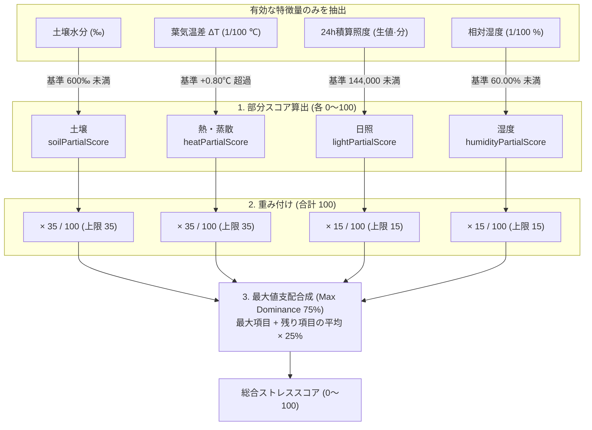
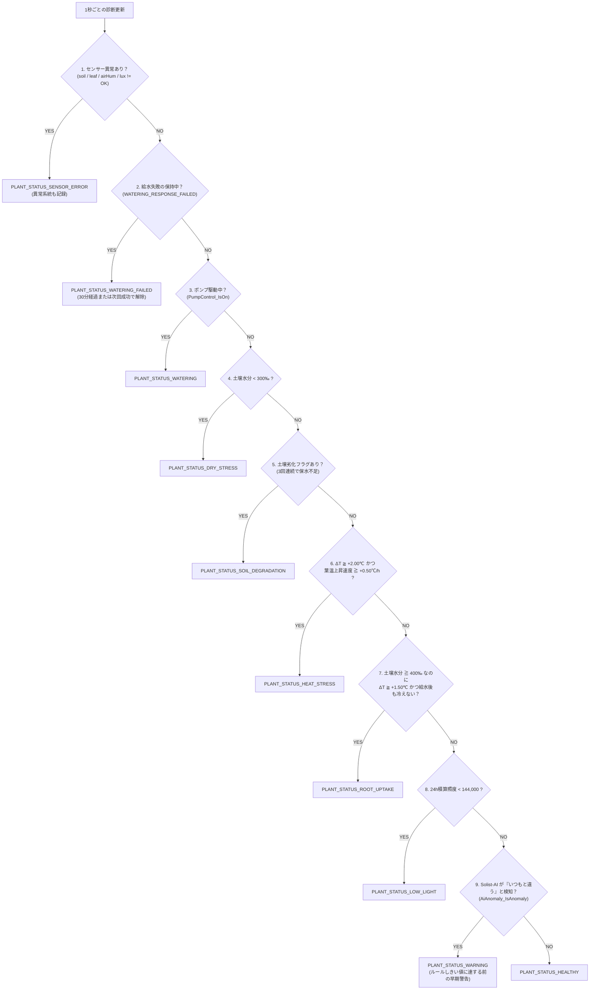

# 第2章 多変量植物ストレス評価と自律診断アルゴリズム

植物の状態を「土が乾いているか・湿っているか」の二択だけで判断すると、強い照明による葉の過熱や、給水しても根が水を吸えていない異常を見落としてしまいます。かといって、すべてを機械学習だけに任せてしまうと、水やりの開始や停止の理由がブラックボックスになり、安全な制御が難しくなります。

そこで Plant Doctor は、植物生理学にもとづくルールベースの評価と、第3章・第4章で解説する Solist-AI の学習を組み合わせています。本章では、4つの環境・生体指標から 0〜100 の数値を算出する**ストレスバロメータ（`PlantStress.c`）**、優先順位にもとづいて原因候補を特定する**状態診断（`PlantDiagnosis.c`）**、そして安全条件と事後確認を備えた**自律給水（`WateringPolicy.c`・`WateringResponse.c`）**の仕組みを解説します。

---

## 2.1 ストレスバロメータ（0〜100）の役割と全体像

ストレスバロメータは、植物が受けている負荷の大きさを 0〜100 の連続した数値で表す指標です。平常時のベーススコア `PLANT_DOCTOR_STRESS_BASE_SCORE` は `0` に設定されており、すべての指標が基準範囲内にあればスコアは **0** になります。

このスコアは LCD や Web ダッシュボードに表示されるだけでなく、**Solist-AI に現在のデータを「いつもの健康な状態」として学習させてよいかどうかの関門**としても使われます。

| スコアの目安 | 植物と環境の状態 | システムの主な動き |
|---|---|---|
| **0 〜 29** | 土壌水分・葉気温差・日照・湿度がいずれも良好（または軽微な変化） | ルール診断が `HEALTHY` などの条件を満たせば **Solist-AI が毎秒学習を実行** |
| **30 〜 49** | 土壌の乾き始めや空気の乾燥など、中程度の負荷 | **定常時の AI 学習を停止**し、異常データを「いつも」として覚えるのを防ぐ（立ち上げの100回未満のみ、土壌・熱の部分スコア40未満なら50未満まで学習許可） |
| **50 以上** | 乾燥や熱ストレスなど、複数の負荷または強い負荷が重なった状態 | AI 学習を完全に止め、ルール診断に応じた警告表示や自動給水を行う |

---

## 2.2 4項目の負荷指標（0〜100）の計算式

`PlantStress_Evaluate`（`ai/PlantStress.c`）では、まず通信状態と妥当性チェック（`SENSOR_HEALTH_OK`）を通過した項目だけを対象に、4つの**部分スコア（Partial Score、各 0〜100）**を求めます。異常と出たセンサーや、まだ履歴がそろっていない項目は対象から外し（マスク）、0点で全体を薄めてしまわないよう配慮しています。



### 1. 土壌の渇き（`soilPartialScore`）

根の周りの水分が平常基準 `baselineSoilMoisturePermille = 600`（$600\text{‰} = 60.0\%$）をどれだけ下回ったかを 0〜100 に換算します。

$$\text{soilPartialScore} = \min\left(100,\; \left\lfloor \frac{\max(0,\; 600 - \text{soilMoisturePermille}) \times 100}{600} \right\rfloor \right)$$

- $600\text{‰}$ 以上なら $0$、給水開始ラインの $300\text{‰}$（$30.0\%$）で $50$、完全なカラカラ状態（$0\text{‰}$）で $100$ になります。

### 2. 葉のほてり・蒸散低下（`heatPartialScore`）

葉気温差 $\Delta T = T_{\text{leaf}} - T_{\text{air}}$ が平常基準 `baselineTempDeltaCentiC = 80`（$+0.80^\circ\text{C}$）を超えた分を、フルスケール幅 `maxHeatDeltaRangeCentiC = 167`（$+1.67^\circ\text{C}$）で割って 0〜100 にします。

```c
/* ai/PlantStress.c: 熱ストレス部分スコアの算出 */
if ((config->maxHeatDeltaRangeCentiC > 0) &&
    (features->leafAirTemperatureDelta > config->baselineTempDeltaCentiC)) {
    int32_t diff = features->leafAirTemperatureDelta - config->baselineTempDeltaCentiC;
    int32_t score = (diff * 100L) / config->maxHeatDeltaRangeCentiC;
    if (score > 100L) {
        score = 100L;
    }
    output->heatPartialScore = (uint8_t)score;
}
```

- $\Delta T \le +0.80^\circ\text{C}$ のときは $0$、気孔が閉じて $\Delta T \ge +2.47^\circ\text{C}$（$0.80 + 1.67$）に達すると上限の $100$ になります。

### 3. 光量不足（`lightPartialScore`）

直近24時間の積算照度 `illuminanceAccumulated`（1分ごとに照度センサーの生値 `illuminanceRaw` を足し上げた24時間合計）を見ます。起動から丸1日分の履歴がたまるまでは評価から除外されます。
- 下限目安 `baselineIlluminanceAccum = 144000`（生値の平均 $100 \times 60\text{分} \times 24\text{時間}$、ルクス換算で平均約 $5.8\text{ lx}$ 相当）を割り込むと、不足割合に応じて $0 \sim 100$ がつきます。

### 4. 空調などによる空気の乾き（`humidityPartialScore`）

相対湿度が平常基準 `baselineHumidityCentiPercent = 6000`（$60.00\%\text{RH}$）を下回った割合です。たとえば湿度 $30.00\%$ なら $50$ になります。

---

## 2.3 重み（35 / 35 / 15 / 15）と最大値支配合成

4つの指標を1つに束ねる際、`PlantDoctorConfig.h` ではそれぞれの重みを次のように定めています。

```c
/* config/PlantDoctorConfig.h */
#define PLANT_DOCTOR_STRESS_WEIGHT_SOIL          (35U)  /* 土壌水分の重み */
#define PLANT_DOCTOR_STRESS_WEIGHT_HEAT          (35U)  /* 熱ストレスの重み */
#define PLANT_DOCTOR_STRESS_WEIGHT_LIGHT         (15U)  /* 日照の重み */
#define PLANT_DOCTOR_STRESS_WEIGHT_HUMIDITY      (15U)  /* 湿度の重み */
#define PLANT_DOCTOR_STRESS_MAX_DOMINANCE_WEIGHT (75U)  /* 最大値支配度[%] */
```

### 重みを 35 / 35 / 15 / 15 にしている理由

各指標 $S_i \in [0, 100]$ には、まず重み $w_i$ が掛けられます。

$$W_i = \left\lfloor \frac{S_i \times w_i}{100} \right\rfloor$$

枯死に直結する**土壌の渇き（35）**と**葉のほてり（35）**を主役に据え、穏やかに効く**光量（15）**と**空気の乾き（15）**を脇役に置いて、4つの重みの合計がちょうど $35 + 35 + 15 + 15 = 100$ になるよう配分しています。

以前は `PlantAi_Init` 内に `100 / 100 / 80 / 60` という大きな重みが直接書かれており、設定ファイルの配分が効いていませんでした。しかし重みが 100 や 60 だと、土の水分が $42\%$（$420\text{‰}$、指標値 30）まで減ったり、部屋の湿度が $30\%$（指標値 50、重み付き 30）になったりしただけで総合値が 30 に達し、植物は元気（`HEALTHY`）なのに Solist-AI の学習が止まってしまう弊害がありました。さらに実機ログ（`0921.json`・`0922.json`）の記録値と比べても、`35 / 35 / 15 / 15` のほうが実機の出力にずっと近く（平均差 $4.9$、旧設定では $17.8$）、日常の緩やかな乾きの範囲では総合値が 30 未満に収まって AI が順調に学び続けられます。

### 最大値支配（Max Dominance）による合成式

有効な項目の重み付き値 $W_i$ のうち、最も大きいものを $P_{\max}$、残りの合計を $P_{\text{other}}$、有効項目数を $N$ とすると、総合値は次式で決まります（`baseStressScore = 0` のとき）。

$$\text{stressScore} = \min\left(100,\; P_{\max} + \left\lfloor \frac{P_{\text{other}} \times (100 - 75)}{100 \times (N - 1)} \right\rfloor \right)$$

```c
/* ai/PlantStress.c: 最大値支配による合成 */
secondaryFactor = 100 - (int32_t)config->maxDominanceWeight; /* 25 */
secondaryAdd = 0;
if (count > 1) {
    secondaryAdd = (otherWeightedSum * secondaryFactor) / (100 * (count - 1));
}
deviation = maxWeightedPartial + secondaryAdd;
if (deviation > 100) {
    deviation = 100;
}
```

全項目を単純平均すると、1つの要素だけが跳ね上がっても残りのゼロで割られて4分の1に薄まってしまいます。最大値支配方式なら、最大の重み付き値 $P_{\max}$ をそのまま土台にし、他の要素も重なったときだけその平均の $25\%$ を上乗せできます。

---

## 2.4 優先順位付きの原因候補診断と AI `WARNING` の統合

ストレスバロメータが「どれくらい負担がかかっているか」という量を表すのに対し、「いま何が起きているか」という原因候補を絞り込むのが `PlantDiagnosis_Update`（`ai/PlantDiagnosis.c`）と `PlantAi.c` です。

次の優先順で上から順に照合し、最初に当てはまったものを現在のステータス（`PLANT_STATUS`）とします。



### ルール診断と Solist-AI 判定の役割分担

1〜8番目までは、誰の目にも明らかな危険や機器トラブルをルールで確実に押さえます。そして1〜8番目のどれにも該当せず、ルール上は `PLANT_STATUS_HEALTHY` と出たときに初めて、9番目の **Solist-AI による「いつもと違う」検知（`AiAnomaly_IsAnomaly`）** を確認します。

```c
/* ai/PlantAi.c: ルール上は健康でも、AIが「いつもと違う」と判定したら WARNING にする */
if ((s_diagnosisState.status == PLANT_STATUS_HEALTHY) && AiAnomaly_IsAnomaly(&s_aiAnomaly)) {
    s_diagnosisState.status = PLANT_STATUS_WARNING;
}
```

たとえば土の水分がまだ $460\text{‰}$（$46\%$）残っていて乾燥しきい値（$300\text{‰}$）には届いていなくても、「普段より土の減り方が速く、葉温の上がり方も違う」と Solist-AI が察知すれば、この時点で `PLANT_STATUS_WARNING` に切り替えて画面やダッシュボードへ知らせます。

---

## 2.5 自律給水の8条件と給水後の自己診断

植物が乾燥ストレス（`PLANT_STATUS_DRY_STRESS`）になったとき、マイコンはポンプ（流量約 $120\text{ mL/min}$）を最大 **10.0 秒間（`PLANT_DOCTOR_PUMP_MAX_ON_TICKS = 1000`、約 20 mL）** 動かして水をやります。ただし、水浸しや空運転を防ぐため、`WateringPolicy_Evaluate`（`app/WateringPolicy.c`）で次の8つの条件をすべて満たしたときだけ自動給水を実行します。

1. 診断ステータスが `PLANT_STATUS_DRY_STRESS` であること。
2. 土壌水分の移動平均が `300‰`（$30.0\%$）未満であること。
3. 自動給水フラグ `autoWateringEnabled` が有効（`true`）であること。
4. 土壌水分センサーが正常（`SENSOR_HEALTH_OK`）であること。
5. タンクに水がある（`tankLiquidDetected == true`）こと。
6. 前回の給水から **30分（`1800` 秒 / `180000` ticks）以上** あいていること。
7. 直前の給水応答が失敗（`WATERING_RESPONSE_FAILED`）でないこと。
8. 当日の給水回数が **6回（`maxDailyCount = 6`）未満** であり、土壌劣化（`SOIL_DEGRADATION`）でもないこと。

なお、手動給水（SW4・コンソールの `W`・ダッシュボードの給水ボタン）を行った場合も、水のやりすぎを防ぐために給水時刻と回数が記録され、そのあと30分間は自動給水を控える設計になっています。

### 給水後の自己診断（30秒・3分・5分）と30分での失敗解除

水をやったあと、`WateringResponse_Update`（`ai/WateringResponse.c`）が経過時間（`s_aiTick` 基準）を追跡し、水がきちんと土と植物に届いたかを3段階で確かめます。

| 判定タイミング | 設定マクロ（既定値） | 確認内容と判定結果 |
|---|---|---|
| **1. 直後確認** | `PLANT_DOCTOR_RESP_IMMEDIATE_SECONDS`（**30秒**） | 土壌水分が給水前より **$+50\text{‰}$（5ポイント）以上** 増えたか。増えていれば浸透確認へ進む |
| **2. 浸透確認** | `PLANT_DOCTOR_RESP_DELAYED_SECONDS`（**180秒＝3分**） | 30秒時点で未達でも、3分後に **$+50\text{‰}$ 以上** 増えていれば土壌回復 OK。3分たっても $+50\text{‰}$ 未満なら、チューブ外れや水量不足とみなして **`WATERING_RESPONSE_FAILED`（給水失敗）** にする |
| **3. 蒸散回復確認** | `PLANT_DOCTOR_RESP_TEMP_DELTA_SECONDS`（**300秒＝5分**） | 土壌水分が回復したあと、5分後に葉気温差 $\Delta T$ が給水前より **$-0.30^\circ\text{C}$（`30`）以上** 下がったか。下がらなければ `wateringDidNotCoolLeaf = true` とし、吸水不良（`ROOT_UPTAKE`）の判断材料にする |

また、給水による土壌水分の増加量が $+80\text{‰}$ 未満しか保てない状態が3回連続した場合は、土の保水力が落ちたとして土壌劣化（`isSoilDegraded = true`）と判定します。

```c
/* ai/WateringResponse.c: 給水失敗は一定時間（30分）が過ぎたら解除し、再び自動給水を試せるようにする */
if ((state->result == WATERING_RESPONSE_FAILED) && (config->failedHoldTicks > 0UL)) {
    if ((input->currentTick - state->wateringStartTick) >= config->failedHoldTicks) {
        state->result = WATERING_RESPONSE_NONE;
    }
    return;
}
```

一度 `WATERING_RESPONSE_FAILED` になると、優先順位とインターロックによって自動給水が止まります。以前はこれを発報後に解除する処理がなかったため、たとえば SW4 でポンプを動かしてすぐ止めたときや、もともと湿り気のある土に手動で足し水をして $+50\text{‰}$ 増えなかったときに、電源を入れ直すまで自動給水が止まったままになっていました。現在のファームウェアでは **`PLANT_DOCTOR_RESP_FAILED_HOLD_SECONDS = 1800UL`（30分）** が経過すると自動的に `WATERING_RESPONSE_NONE` へ戻り、再び自動給水を試せるようになっています。

さらに、SW4 だけでなく UART コンソールの `W` や Web ダッシュボードからの給水指示もすべて `AppStateMachine_RequestManualWatering` に統一し、給水前の土壌水分と葉気温差を必ず `PlantAi_NotifyWatering` に記録してからポンプを動かすことで、どの経路で給水しても上記の自己診断が正しく働くようになっています。

---

## ナビゲーション

**[← 第1章 エッジAIと植物生体センシング技術](01_edge_ai_and_sensing.md)** ｜ [目次 (README)](README.md) ｜ **[第3章 自己符号化器（Autoencoder）と多次元生体異常検知 →](03_autoencoder_and_anomaly_detection.md)**
