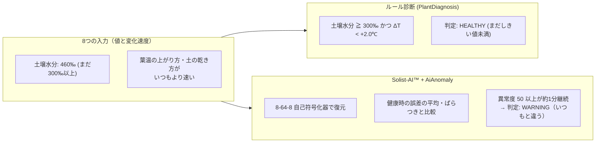
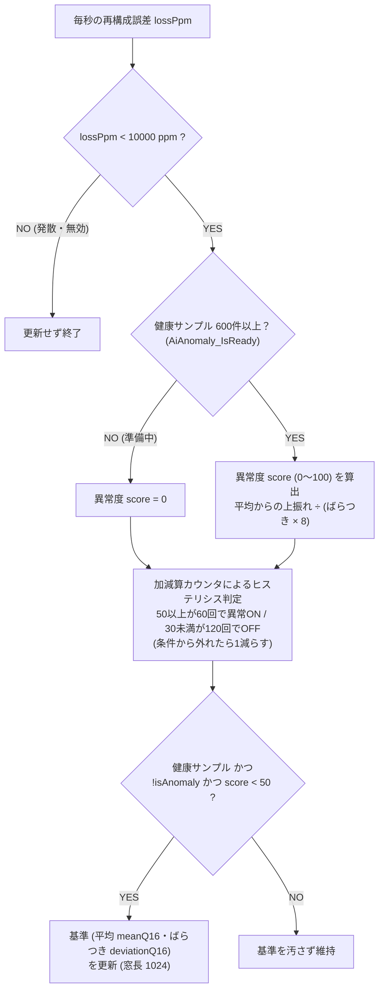

# 第3章 自己符号化器（Autoencoder）と多次元生体異常検知

第2章で見たルールベースの診断は、「土壌水分が $300\text{‰}$（$30\%$）を切ったら水やり」「葉気温差 $\Delta T$ が $+2.00^\circ\text{C}$ 以上なら熱ストレス」といった明確な危険を確実に捉えます。しかし、固定のしきい値だけでは、「普段は1時間に $0.6$ ポイントずつゆっくり乾く鉢なのに、今日は1時間に $6$ ポイントの速さで乾き始め、葉温もじわじわ上がっている」といった、**しきい値に達する前の異変**には気づけません。

また、植物の種類や鉢の大きさ、土の配合、照明との距離が違えば、「普段の乾き方」や「照明がついたときの葉温の上がり方」は鉢ごとに異なります。本章では、ROHM ML63Q2557 に内蔵された **Solist-AI™** の自己符号化器（Autoencoder）を使ってその株の「いつも」を学び、再構成誤差のずれから異常度（0〜100）と「いつもと違う」（`WARNING`）を判定する仕組み（`PlantAi.c`・`AiAnomaly.c`）を詳しく解説します。

---

## 3.1 なぜ「元気なときの姿だけ」を学ぶのか

植物の不調には、水切れ、根詰まり、根腐れ、日照の変化、空調の直撃など多様な要因があり、あらかじめ「病気のときのデータ」を網羅して覚えさせるわけにはいきません。一方で、目の前にある鉢植えから毎日届く記録の大部分は「その株の普段どおりの姿」です。

そこで Plant Doctor では、**健康なときのセンサーの組み合わせだけを自己符号化器に記憶させ、普段の調和から外れたときに復元ロス（再構成誤差）が膨らむ性質を使った教師なし異常検知**を行っています。



---

## 3.2 Solist-AI に入れる8次元の特徴量と正規化

`PlantAi_Process10Ms`（`ai/PlantAi.c`）では、1秒ごとに取得したセンサー値とその変化速度から **8次元の特徴量ベクトル $\mathbf{x} = [x_0, x_1, \dots, x_7]^T$** を作り、Solist-AI に入力します。

### 8つの入力項目と正規化範囲

Solist-AI の出力層は Sigmoid 活性化関数（`ODL_ACTV_SIGMOID`、出力範囲 $0.0 \sim 1.0$）を使うため、入力値も $[0.0, 1.0]$ に収める必要があります。ファームウェアでは `NormalizeToQ8` 関数で各物理量を $0 \sim 256$（固定小数点 Q8 形式の $0.0 \sim 1.0$）へ線形変換したあと、`ODL_ToBfloat16` で 16 ビット浮動小数点（`bfloat16`）の配列に変換します。

| 要素 | 特徴量（変数名） | 正規化範囲（最小〜最大） | 単位・設定の意図 |
|---|---|---|---|
| **$x_0$** | **土壌水分**（`soilMoisturePermille`） | $0 \sim 1000$ | $\text{‰}$（$0.0\% \sim 100.0\%$）。校正後の土壌水分 |
| **$x_1$** | **葉面温度**（`leafTemperatureCentiC`） | $1000 \sim 4000$ | $1/100^\circ\text{C}$（$10.00^\circ\text{C} \sim 40.00^\circ\text{C}$） |
| **$x_2$** | **環境気温**（`airTemperatureCentiC`） | $1000 \sim 4000$ | $1/100^\circ\text{C}$（$10.00^\circ\text{C} \sim 40.00^\circ\text{C}$） |
| **$x_3$** | **葉気温差 $\Delta T$**（`leafAirTemperatureDelta`） | $-400 \sim +200$ | $1/100^\circ\text{C}$（$-4.00^\circ\text{C} \sim +2.00^\circ\text{C}$） |
| **$x_4$** | **相対湿度**（`relativeHumidityCentiPercent`） | $2000 \sim 10000$ | $1/100\%$（$20.00\% \sim 100.00\%\text{RH}$） |
| **$x_5$** | **照度（生値）**（`illuminanceRaw`） | $0 \sim 6000$ | **照度センサーの生値**（1カウント $\approx 0.0576\text{ lx}$、点灯時は約1350） |
| **$x_6$** | **葉温の変化速度**（`leafTemperatureRatePerHour`） | $-300 \sim +300$ | $1/100^\circ\text{C}/\text{h}$（**$-3.00 \sim +3.00^\circ\text{C}/\text{h}$**） |
| **$x_7$** | **土壌水分の変化速度**（`soilMoistureRatePerHour`） | $-60 \sim +60$ | $\text{‰}/\text{h}$（**$-60 \sim +60\text{‰}/\text{h}$**、すなわち $\pm 6.0\%/\text{h}$） |

```c
/* ai/PlantAi.c: 8次元特徴量の Q8 正規化 (0〜256) */
bool isRateReady = (s_featureState.minuteHistoryCount >= PLANT_DOCTOR_AI_RATE_READY_MINUTES);
rawFeatures[0] = NormalizeToQ8(featureInput.soilMoisturePermille, 0, 1000);
rawFeatures[1] = NormalizeToQ8(snapshot.leafTemperatureCentiC, 1000, 4000);
rawFeatures[2] = NormalizeToQ8(snapshot.airTemperatureCentiC, 1000, 4000);
rawFeatures[3] = NormalizeToQ8(s_featureVector.leafAirTemperatureDelta, -400, 200);
rawFeatures[4] = NormalizeToQ8(snapshot.relativeHumidityCentiPercent, 2000, 10000);
rawFeatures[5] = NormalizeToQ8(snapshot.illuminanceRaw, 0, 6000);
/* 変化速度は範囲を狭め、その株らしい葉温の上がり方・土の乾き方からのずれを誤差に表れやすくする */
rawFeatures[6] = isRateReady ? NormalizeToQ8(s_featureVector.leafTemperatureRatePerHour,
                                             -PLANT_DOCTOR_AI_LEAF_RATE_RANGE_CENTIC,
                                             PLANT_DOCTOR_AI_LEAF_RATE_RANGE_CENTIC) : 128;
rawFeatures[7] = isRateReady ? NormalizeToQ8(s_featureVector.soilMoistureRatePerHour,
                                             -PLANT_DOCTOR_AI_SOIL_RATE_RANGE_PERMILLE,
                                             PLANT_DOCTOR_AI_SOIL_RATE_RANGE_PERMILLE) : 128;
```

### 変化速度（$x_6, x_7$）の範囲設定と起動後15分間の待機

このコードには、実機とシミュレーションの検証から生まれた2つの重要な工夫が入っています。

1. **変化速度の正規化範囲を狭めて感度を上げる**:
   以前は葉温の変化速度を $\pm 5.00^\circ\text{C}/\text{h}$、土壌水分の変化速度を $\pm 200\text{‰}/\text{h}$ で正規化していました。しかしその広い範囲では、普段のゆっくりした乾き（たとえば $0.6\%/\text{h} = 6\text{‰}/\text{h}$）と異常な速さの乾き（$6\%/\text{h} = 60\text{‰}/\text{h}$）の差が $0 \sim 256$ のスケール上で小さくなり、再構成誤差に表れにくくなります。そこで `PLANT_DOCTOR_AI_LEAF_RATE_RANGE_CENTIC = 300`（$\pm 3.00^\circ\text{C}/\text{h}$）、`PLANT_DOCTOR_AI_SOIL_RATE_RANGE_PERMILLE = 60`（$\pm 60\text{‰}/\text{h}$）へと範囲を絞り、変化のしかたの違いが誤差に大きく反映されるようにしています。
2. **履歴が15分たまるまでは中間値（`128`）を入れる**:
   `PlantFeature.c` は1分ごとの履歴（最大60件＝60分）の最も古い点と新しい点の差から1時間あたりの変化速度を計算します。そのため、電源を入れた直後で履歴が2〜3分しかないときには、土壌水分がわずか $1\text{‰}$ 揺れただけで「1時間あたり $20 \sim 30\text{‰}/\text{h}$」と大きく拡大されてしまい、その時期に作られた誤差の基準のばらつきが大きくなって感度が落ちていました。
   そこで、1分ごとの履歴が **15件（`PLANT_DOCTOR_AI_RATE_READY_MINUTES = 15`、約15分）** たまるまでは、`isRateReady` を `false` とし、$x_6$ と $x_7$ には「変化なし（0）」にあたる中間値 `128`（$0.5$）を入れます。

---

## 3.3 8-64-8 自己符号化器と再構成誤差（ppm）

Solist-AI アクセラレータ（`AI_PERI`）は、入力層 8 ノード・隠れ層 64 ノード・出力層 8 ノードの3層自己符号化器を実行します。入力ベクトル $\mathbf{x} \in [0.0, 1.0]^8$ を隠れ層へ圧縮して再び8次元ベクトル $\hat{\mathbf{x}}$ へ復元し、両者の二乗平均誤差（MSE）を `bfloat16` 形式で返します。

$$\text{MSE} = \frac{1}{8} \sum_{i=0}^{7} (x_i - \hat{x}_i)^2$$

ファームウェアでは `OSUAD_GetLoss()` から得た誤差を `0.0f`〜`1.0f` にクリップしたうえで $10,000$ 倍し、整数 `s_solistAiLatestLossPpm`（$0 \sim 10000\text{ ppm}$）に変換します。たとえば実機ログ（9月24日 13:00〜9月25日 22:20 の健康な状態）における再構成誤差の平均は約 $0.0235$（ばらつき約 $0.0007$）であり、ppm 表記では **約 $235\text{ ppm}$（ばらつき約 $7\text{ ppm}$）** にあたります。

---

## 3.4 株ごとの誤差基準の学習と異常度（0〜100）の算出（`AiAnomaly.c`）

再構成誤差の絶対値は、鉢の環境やセンサーの揺らぎ方によって少しずつ異なります。そのため「誤差が何 ppm を超えたら異常」と固定値で決めるのではなく、`AiAnomaly.c` で**その株が健康なときの再構成誤差の平均（水準）とばらつき（平均絶対偏差）を学び、そこからの上振れを異常度 0〜100 に換算**しています。



### 1. 健康時の水準と揺れ幅の学習

`AiAnomaly_Update` は、次の条件をすべて満たすデータだけを「基準の算出に使ってよい健全な標本」として受け入れます。
- ルール診断が健康かつ低負荷などの関門（`isRuleSafe`）を通過していること
- 起動後15分が経過して推移履歴がそろっていること（`isRateReady == true`）
- Solist-AI の累積学習回数が **100回以上**（`PLANT_DOCTOR_AI_ANOMALY_MIN_TRAIN_COUNT = 100`）に達していること
- 現在「いつもと違う」と出ておらず（`!state->isAnomaly`）、スコアも開始ライン未満（`state->score < 50`）であること

マイコン上で浮動小数点を使わずに済むよう、ppm 値を 16 ビット左シフトした Q16 固定小数点（`meanQ16`・`deviationQ16`）で保持します。最初の 1024 件未満（$n < 2^{10}$）は立ち上がりを速めるため単純平均（$1/n$）で馴染ませ、それ以降は窓長 $2^{10} = 1024$ 件（`PLANT_DOCTOR_AI_ANOMALY_BASELINE_SHIFT = 10`、約17分）の指数移動平均で緩やかに追従させます。

```c
/* ai/AiAnomaly.c: 健康時の平均とばらつき（平均絶対偏差）の更新 */
int32_t err = xq - state->meanQ16;
int32_t absErr = (err < 0) ? -err : err;
uint32_t n = state->baselineSamples + 1U;
uint32_t window = 1UL << config->baselineShift; /* 1024 */
if (n < window) {
    /* 立ち上がりは単純平均で早く収束させる */
    state->meanQ16 += err / (int32_t)n;
    state->deviationQ16 += (absErr - state->deviationQ16) / (int32_t)n;
} else {
    state->meanQ16 += err / (int32_t)window;
    state->deviationQ16 += (absErr - state->deviationQ16) / (int32_t)window;
}
```

### 2. 監視開始までの時間と異常度（0〜100）の計算式

健全な標本が **600件（`PLANT_DOCTOR_AI_ANOMALY_MIN_BASELINE_SAMPLES = 600`、約10分）** 集まると `AiAnomaly_IsReady` が `true` になり、異常度の算出が始まります。変化速度の履歴がたまるまでの15分と合わせると、**電源投入から約25分で「いつもと違う」の見守りが始まる**計算です（それまでの準備中は `0` を返します）。

準備完了後の `score`（$0 \sim 100$）は、足元のロスが平常水準 `meanQ16` からどれだけ上振れしたかを、普段の揺れ幅 `deviation` の倍率で表した値です。

$$\text{score} = \min\left(100,\; \left\lfloor \frac{\max(0,\; \text{lossPpm} - \text{mean}) \times 100}{\max(\text{deviation},\; 15\text{ ppm}) \times 8} \right\rfloor \right)$$

- **揺れ幅の下限（`minDeviationPpm = 15`）**: 室温や光が一定でロスがほとんど動かない時間帯に、分母が小さくなりすぎて過敏に反応するのを防ぐため、下限を $15\text{ ppm}$（MSE で $0.0015$）に置いています。
- **倍率の換算（`deviationScale = 8`）**: 平常水準からの上振れが揺れ幅の **8倍** に達したときに **100**、**4倍** で開始ラインの **50** になります。たとえば水準が $235\text{ ppm}$、揺れ幅が下限の $15\text{ ppm}$ の株なら、ロスが $235 + 15 \times 4 = 295\text{ ppm}$ へ跳ね上がると 50 に達します。
- **実機記録での裏付け**: 9月24日〜25日の実機ログ（元気な約21時間）の推移にこの式を当てはめると、最高でも **20** に収まり、警戒ラインの 50 を超えた時点は一度もありませんでした。

---

## 3.5 外れたら1つ減らす加減算カウンタとヒステリシス

復元ロスは毎秒わずかに上下するため、たった1秒だけ 50 を超えたからといって即座に `WARNING` を出すと誤報になります。かといって、「60回連続で 50 以上なら発報し、途中で1度でも 50 を割ったらゼロから数え直す」という単純な連続方式にすると、50 前後で小刻みに揺れている局面で何度も振り出しに戻され、想定値の試算でも最初に 50 を超えてから `WARNING` が出るまで 44 分を要していました。

そこで `AiAnomaly.c` では、**条件を満たせば 1 増やし、外れてもゼロには戻さず 1 だけ減らす加減算カウンタ（ヒステリシス付き）** を取り入れています。

```c
/* ai/AiAnomaly.c: 1回外れても数え直さず、1つ減らすヒステリシス判定 */
if (state->score >= config->onScore) {          /* onScore = 50 */
    if (state->aboveCount < config->onSamples) { /* onSamples = 60 (約1分) */
        ++state->aboveCount;
    }
    if (state->belowCount > 0U) {
        --state->belowCount;
    }
} else if (state->score < config->offScore) {   /* offScore = 30 */
    if (state->belowCount < config->offSamples) {/* offSamples = 120 (約2分) */
        ++state->belowCount;
    }
    if (state->aboveCount > 0U) {
        --state->aboveCount;
    }
} else {                                        /* 30 <= score < 50 */
    if (state->aboveCount > 0U) {
        --state->aboveCount;
    }
    if (state->belowCount > 0U) {
        --state->belowCount;
    }
}
if (!state->isAnomaly && (state->aboveCount >= config->onSamples)) {
    state->isAnomaly = true;
    state->belowCount = 0U;
} else if (state->isAnomaly && (state->belowCount >= config->offSamples)) {
    state->isAnomaly = false;
    state->aboveCount = 0U;
}
```

| 設定項目 | マクロ名 | 設定値 | 意味 |
|---|---|---|---|
| **開始スコア** | `PLANT_DOCTOR_AI_ANOMALY_ON_SCORE` | **50** | この値以上で `aboveCount` を $+1$ する |
| **開始サンプル数** | `PLANT_DOCTOR_AI_ANOMALY_ON_SAMPLES` | **60**（約1分） | `aboveCount` が 60 に達したら `isAnomaly = true`（`WARNING`）にする |
| **解除スコア** | `PLANT_DOCTOR_AI_ANOMALY_OFF_SCORE` | **30** | この値未満で `belowCount` を $+1$ する |
| **解除サンプル数** | `PLANT_DOCTOR_AI_ANOMALY_OFF_SAMPLES` | **120**（約2分） | `belowCount` が 120 に達したら `isAnomaly = false` に戻す |

カウンタの上限をそれぞれ `60` と `120` で頭打ちにしているため、平常状態が何時間続いたあとでも、異変が起きれば最短約1分で `WARNING` になり、収まれば最短約2分で解除されます。

さらに、水やりが行われた直後は土壌水分の変化速度が大きく振れるため、`AiAnomaly_ClearJudgement` によって**学習済みの基準（`meanQ16`・`deviationQ16`・`baselineSamples`）はそのまま残し、判定状態（`score`・`isAnomaly`・カウンタ）だけをリセットして1時間半休止**します。この給水後の休止と、健康なモデルを汚さないための7つの学習関門については、次の第4章で詳しく解説します。

---

## ナビゲーション

**[← 第2章 多変量植物ストレス評価と自律診断アルゴリズム](02_plant_stress_scoring.md)** ｜ [目次 (README)](README.md) ｜ **[第4章 オンデバイス逐次学習（ODL）の数学と7つの関門 →](04_on_device_learning_mechanism.md)**
