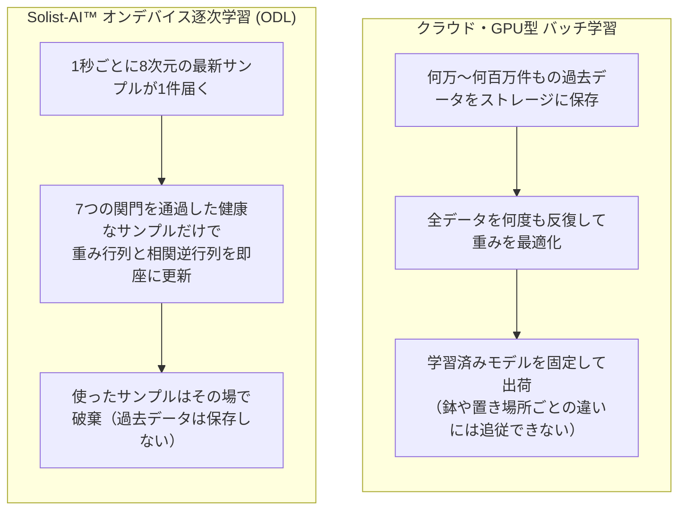
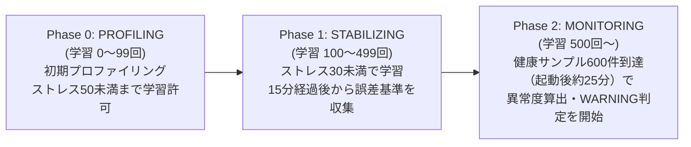
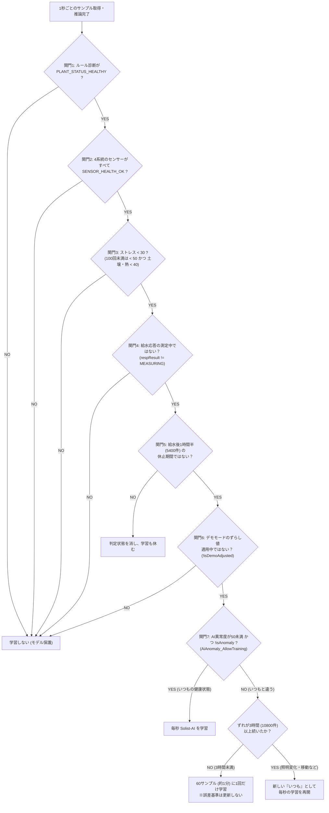

# 第4章 オンデバイス逐次学習（ODL）の数学と7つの関門

一般的な機械学習では、大量のデータをサーバーに集めて何度も繰り返し学習させる「バッチ学習」が使われます。しかし ROHM ML63Q2557 の内蔵 RAM は **16 KB**（Flash は 256 KB）しかなく、1秒ごとに届くセンサーの履歴を何日分も蓄えておく余裕はありません。さらに、植物を現場で見守るエッジ AI にとって最も危険なのは、**「水切れや高温で苦しんでいるときの異常なデータを、いつもの健康な状態として覚えてしまうこと（モデルの汚染）」**です。

そこで Plant Doctor は、「植物の『いつも』をその場で覚え、異常のときは覚えないエッジ AI」を実現するために、過去データを保持しない **オンデバイス逐次学習（Online Sequential Learning）** と、学習の前に置いた **7つの関門** を組み合わせています。本章ではその数理とファームウェア実装（`PlantAi.c`・`AiAnomaly.c`）を詳しく解説します。

---

## 4.1 データ非保持型逐次学習（ODL）とメモリ消費量 $O(1)$

バッチ学習と、Solist-AI™ が行うオンデバイス逐次学習（ODL）の違いを整理します。



| 比較項目 | バッチ学習 | Solist-AI™ オンデバイス逐次学習（ODL） |
|---|---|---|
| **過去データの保存** | 必須（大容量ストレージが必要） | **不要（1件ごとに重みへ反映して即座に破棄）** |
| **学習する場所** | クラウドサーバー・PC | **鉢の横にある ML63Q2557 内蔵アクセラレータ（`AI_PERI`）** |
| **必要な RAM 容量** | 数百 MB 〜 数十 GB | **数 KB（16 KB RAM のマイコンで常時稼働）** |
| **鉢・環境への適応** | 固定（出荷時のまま） | **その株・鉢・土・照明の「いつも」を現場で学習** |

1秒に1回サンプリングすると、1日で 86,400 件のデータが生まれます。ODL では新しいサンプルが1件届くたびに、その統計情報をモデルの内部行列へ織り込んでサンプル自体は捨てるため、**何日間連続で動かしても学習データのために RAM が増えることはありません**。

---

## 4.2 逐次最小二乗法（RLS）と忘却係数 $\lambda = 1.0$

過去データを保存せずに学習を積み重ねられる理由は、出力層の重み更新に **逐次最小二乗法（Recursive Least Squares: RLS）** と **シャーマン・モリソンの公式（Sherman-Morrison Formula）** を使っているためです。

### 1. 保持する状態変数と更新式

隠れ層（64ノード）の出力ベクトルを $\mathbf{h}_t \in \mathbb{R}^{64}$、目標となる入力ベクトルを $\mathbf{x}_t \in \mathbb{R}^8$ としたとき、モデルが保持するのは **重み行列 $\mathbf{W}_t \in \mathbb{R}^{64 \times 8}$** と、過去の特徴量の共分散情報を要約した **相関逆行列 $\mathbf{P}_t \in \mathbb{R}^{64 \times 64}$** の2つだけです。新しいサンプルが届くと、次の3ステップで行列を更新します。

1. **ゲインベクトル $\mathbf{k}_t$ の算出**:
   $$\mathbf{k}_t = \frac{\mathbf{P}_{t-1} \mathbf{h}_t}{\lambda + \mathbf{h}_t^T \mathbf{P}_{t-1} \mathbf{h}_t}$$
   分母がスカラーになるため、計算量の大きい逆行列演算（$O(N^3)$）を行わずに $O(N^2)$ で更新できます。
2. **重み行列 $\mathbf{W}_t$ の更新**:
   $$\mathbf{W}_t = \mathbf{W}_{t-1} + \mathbf{k}_t (\mathbf{x}_t - \hat{\mathbf{x}}_t)^T$$
3. **相関逆行列 $\mathbf{P}_t$ の更新**:
   $$\mathbf{P}_t = \frac{1}{\lambda} \left( \mathbf{P}_{t-1} - \mathbf{k}_t \mathbf{h}_t^T \mathbf{P}_{t-1} \right)$$

### 2. 忘却係数を $\lambda = 1.0$ に固定する理由

式中の $\lambda$（$0 < \lambda \le 1$）は忘却係数です。$\lambda < 1.0$ にすると古い記憶を早く忘れるようになりますが、植物のように変化が穏やかな対象で $\lambda < 1.0$ のまま何日も学習を続けると、$\mathbf{P}_t$ が $1/\lambda$ 倍され続けて数値が発散する「共分散ワインドアップ（Covariance Wind-up）」が起きます。

そのため `PlantAi_Init` では、忘却係数を **`1.0`（`bfloat16` で `0x3F80`）** に設定し、長期間の連続運転でも数値が発散しないようにしています。

```c
/* ai/PlantAi.c: Solist-AI 初期化パラメータ */
s_solistAiParams.inputSize = SOLIST_AI_FEATURE_DIM;  /* 8 */
s_solistAiParams.hiddenSize = 64U;                   /* 64 */
s_solistAiParams.outputSize = SOLIST_AI_FEATURE_DIM; /* 8 */
s_solistAiParams.forgettingFactor = 0x3F80;          /* 1.0 (bfloat16) */
s_solistAiParams.activationFunction = ODL_ACTV_SIGMOID;
s_solistAiParams.lossFunction = ODL_LOSS_MSE;
```

---

## 4.3 学習の進行段階と判定開始までの流れ

電源を入れてからの累積学習回数 `s_solistAiTrainCount` に応じて、システムは3つの段階（`s_solistAiPhase`）を進みます。同時に、第3章で解説した変化速度の履歴待機（15分）と誤差基準の学習（600件）が進みます。



```c
/* ai/PlantAi.c: 累積学習回数に応じたフェーズ更新 */
++s_solistAiTrainCount;
if (s_solistAiTrainCount < 100U) {
    s_solistAiPhase = 0U; /* PROFILING */
} else if (s_solistAiTrainCount < 500U) {
    s_solistAiPhase = 1U; /* STABILIZING */
} else {
    s_solistAiPhase = 2U; /* MONITORING */
}
```

1. **起動〜15分**: 1分ごとの履歴がまだ短いため、変化速度の特徴量（$x_6, x_7$）は中間値 `128` に固定して Solist-AI を学習させます。最初の100回（Phase 0）は立ち上げ時のわずかな偏りで学習が止まらないよう、土壌・熱の部分スコアが40未満なら総合ストレス50未満まで学習を許可します。
2. **15分〜約25分**: 変化速度の履歴が15分分たまり（`isRateReady == true`）、かつ学習回数が100回以上（Phase 1〜2）になると、`AiAnomaly_Update` が健康なときの再構成誤差の平均とばらつきを集め始めます。
3. **起動後約25分以降**: 健康なサンプルが **600件（約10分）** たまると基準が確立し（`AiAnomaly_IsReady == true`）、異常度 0〜100 の算出と `WARNING` 判定が始まります。

---

## 4.4 健康なモデルを汚さない「7つの関門」

オンデバイス学習で最も重要なのが、「いつ学び、いつ学ばないか」の制御です。`PlantAi.c` と `AiAnomaly.c` では、学習（`OSUAD_StartTrain`）の前に**7つの関門**を置き、健康なモデルが異常データや過渡状態によって汚されるのを防いでいます。



### 関門1〜4：ルール診断・センサー健全性・低ストレス・給水応答測定外

まずルール上の安全条件（`isRuleSafe`）として、①診断が `PLANT_STATUS_HEALTHY` であること、②土壌・葉温・温湿度・照度の4系統すべてが `SENSOR_HEALTH_OK` であること、③ストレススコアが `30` 未満（学習100回未満の立ち上げ時のみ、土壌・熱の部分スコアが `40` 未満なら `50` 未満）であること、④給水後5分間の効果測定中（`WATERING_RESPONSE_MEASURING`）ではないことを確認します。

### 関門5：給水後1時間半（5400サンプル）の休止

水やりが行われると、土壌水分は数分間で急激に上がります。ところが、Solist-AI に入力している土壌水分の変化速度（$x_7$）は**直近60分間の履歴**から計算されるため、土が湿り終わったあとも60分間は「土壌水分が猛烈な速さで増えている」という値が特徴量に残り続けます。想定値の計算で確かめたところ、給水直後に AI の判定や学習を動かすと、給水が成功（OK）したあとも約1時間にわたって再構成誤差が跳ね上がり、`WARNING` が出続けてしまうことが分かりました。

そこで、自動・手動を問わずポンプが動いたとき（`PlantAi_NotifyWatering`）には、**`PLANT_DOCTOR_AI_POST_WATERING_HOLD_SAMPLES = 5400`（1秒周期で5400サンプル＝1時間半）** の休止カウンタをセットします。

```c
/* ai/PlantAi.c: 給水通知時に1時間半（5400サンプル）の休止を設定 */
void PlantAi_NotifyWatering(const PUMP_WATERING_EVENT *event, uint32_t currentTick) {
    (void)currentTick;
    WateringResponse_NotifyWatering(&s_wateringRespState, event, s_aiTick);
    /* 給水後は約1時間半、AIの判定と学習を休む（給水で直前の「いつもと違う」も解除する） */
    s_aiPostWateringHoldSamples = PLANT_DOCTOR_AI_POST_WATERING_HOLD_SAMPLES;
    AiAnomaly_ClearJudgement(&s_aiAnomaly);
}
```

この1時間半の間は、Solist-AI の学習を行わないだけでなく、`AiAnomaly_ClearJudgement` によって異常度（`score`）と `WARNING` 判定（`isAnomaly`）を `0` / `false` に保ちます。一方で、給水前までに学んだ**健康時の誤差の平均（`meanQ16`）とばらつき（`deviationQ16`）は消さずに残してある**ため、1時間半が過ぎて変化速度の履歴が落ち着けば、すぐに元の基準で監視を再開できます（もちろん休止中も、給水失敗などのルール診断は休まず動いています）。

### 関門6：デモモードのオフセット補正中は学ばない

展示や動作確認で使うデモモード（DEMO2・DEMO3・DEMO5）では、スイッチやコンソール操作で土壌水分や葉温に擬似的なオフセット（ずらし値）を加えます。このオフセットはルール診断とストレス算出のコピー（`diagFeatures`・`diagHealth`）にだけ適用され、DEMO3 では実際に乾燥ストレスと判定されてポンプが動きます。しかし、オフセットが1つでも入っている間（`isDemoAdjusted == true`）は Solist-AI の学習を止めるため、デモ操作で AI のモデルや誤差基準が汚れることはありません。

### 関門7：異常時の学習間引き（1分に1回）と、3時間後の学び直し

関門1〜6をすべて通過して `isRuleSafe == true` になったとしても、ルールしきい値に達する前の「いつもと違う」変化が始まっているかもしれません。そこで最後に `AiAnomaly_AllowTraining`（`ai/AiAnomaly.c`）を通します。

```c
/* ai/AiAnomaly.c: いつもと違う間は学習を絞り、3時間続いたら学び直す */
bool AiAnomaly_AllowTraining(AI_ANOMALY_STATE *state, const AI_ANOMALY_CONFIG *config, bool isRuleSafe) {
    if ((state == NULL) || (config == NULL) || !isRuleSafe) {
        return false;
    }
    if (!state->isAnomaly && (state->score < config->onScore)) {
        state->deviatingSamples = 0U;
        return true;
    }
    if (state->deviatingSamples < UINT16_MAX) {
        ++state->deviatingSamples;
    }
    if (state->deviatingSamples >= config->relearnAfterSamples) {
        return true;
    }
    return (config->relearnEverySamples > 0U) &&
           ((state->deviatingSamples % config->relearnEverySamples) == 0U);
}
```

- **平常時（`!isAnomaly` かつ `score < 50`）**: 毎秒（1サンプルごと）Solist-AI を学習させ、誤差の基準も更新します。
- **いつもと違う間（`score >= 50` または `isAnomaly == true`）**: 進行中の乾燥や異常を「いつも」として覚えてしまわないよう、誤差の基準更新を止め、Solist-AI の学習も **`relearnEverySamples = 60`（60サンプル＝約1分に1回）** だけに絞ります。
- **3時間（10800サンプル）続いたときの学び直し**: もしルール上は健康でストレスも30未満のまま、「いつもと違う」状態が **`relearnAfterSamples = 10800`（約3時間）** 続いた場合は、植物の異常ではなく「照明の点灯・消灯」や「鉢の置き場所の変更」によって環境が切り替わったと判断し、新しい「いつも」に馴染ませるために毎秒の学習を再開します。
  - **なぜ30分ではなく3時間なのか**: 第2章で述べたとおり、ストレスの重みを `35 / 35 / 15 / 15` にしたことで、土壌水分が $52\%$ から $30\%$ へ乾いていく途中でもストレススコアは 30 未満に保たれます。想定値の計算で検証したところ、学び直しまでの時間が30分（1800サンプル）だと、乾いている最中に30分が経過して「速い乾き」を新しい「いつも」として覚え直してしまい、`WARNING` が途中で消えてしまうことが分かりました。そこで学び直しまでの時間を **3時間（10800サンプル）** に延ばし、数時間かけて進む乾燥のあいだ `WARNING` を維持できるようにしています。

---

## 4.5 数値発散ウォッチドッグとタイムアウト時の安全停止

長期間の稼働中に強いノイズなどでアクセラレータ内部の演算が飽和したり、ハードウェアが応答しなくなったりした場合でも、システム全体の監視やポンプ制御を止めないための保護処理を入れています。

```c
/* ai/PlantAi.c: 数値発散ウォッチドッグによるモデルと基準の初期化 */
if (fLoss >= 1.0f) {
    if (++s_solistAiDivergenceCount >= 10U) {
        OSUAD_Initialize(&s_solistAiParams, 1U);
        s_solistAiDivergenceCount = 0U;
        s_solistAiLatestLossPpm = 250U;
        /* モデルを作り直したら、学習の段階と異常度の基準も最初から作り直す */
        s_solistAiTrainCount = 0U;
        s_solistAiPhase = 0U;
        AiAnomaly_Reset(&s_aiAnomaly);
    }
} else {
    s_solistAiDivergenceCount = 0U;
}
```

1. **数値発散からの自己修復**: 学習可能な健康状態であるにもかかわらず、再構成誤差が最大値（`1.0f`＝`10000 ppm`）に張り付いた状態が **10回連続** した場合は、`OSUAD_Initialize` で Solist-AI の重みを初期化します。このとき、累積学習回数 `s_solistAiTrainCount` と学習フェーズ `s_solistAiPhase` を `0` に戻し、`AiAnomaly_Reset` で異常度の基準も最初から作り直すことで、モデルと基準の食い違いを防ぎます。
2. **アクセラレータ応答タイムアウト時の安全停止**: `OSUAD_StartPredict` や `OSUAD_StartTrain` の完了待ちループ（上限 `50000` ループ、待機中もウォッチドッグをクリア）がタイムアウトした場合は、`s_solistAiInitialized = false` にして以降の AI 呼び出しを止めるとともに、`AiAnomaly_Reset(&s_aiAnomaly)` で異常度を `0` にリセットします。これにより、AI が止まったあともルール診断と自動給水はそのまま動き続けます。

---

## ナビゲーション

**[← 第3章 自己符号化器（Autoencoder）と多次元生体異常検知](03_autoencoder_and_anomaly_detection.md)** ｜ [目次 (README)](README.md) ｜ **[第5章 システム統合・通信テレメトリと生体コックピット →](05_system_integration_and_telemetry.md)**
