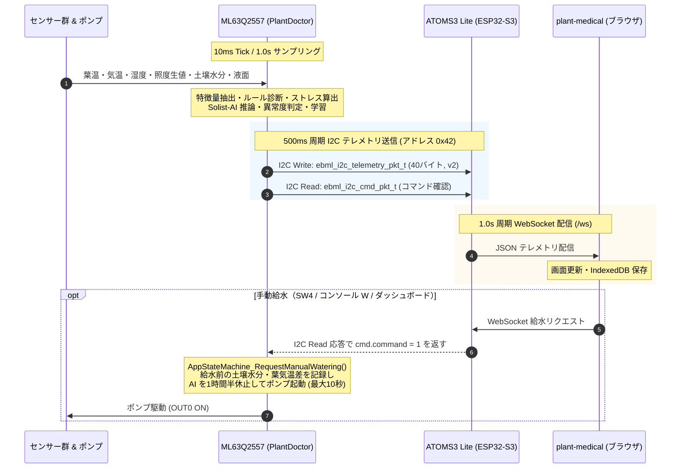

# 第5章 システム統合・通信テレメトリと生体コックピット

第1章から第4章までで、ROHM ML63Q2557 マイコンの内部で動くセンシング、ルール診断・ストレス算出、Solist-AI による異常度判定と7つの学習関門について解説しました。

Plant Doctor はマイコン基板1枚でも16×2 キャラクタ LCD とスイッチ（SW1〜SW4）を使ってその場で状態確認と水やりができますが、さらに **ATOMS3 Lite（ESP32-S3）ゲートウェイ** と **Web ダッシュボード「plant-medical」**、および **UART コンソール** をつなぐことで、8次元特徴量や再構成誤差・異常度の推移をリアルタイムに観察したり、遠隔から手動給水を行ったりできます。本章では、これらを結ぶ通信プロトコルと UI の実装を詳しく解説します。

---

## 5.1 3層の連携と手動給水経路の統一

センサーの読み取りからブラウザの表示、そして手動給水の指示が戻るまでの流れは次のとおりです。



### 手動給水経路の統一（`AppStateMachine_RequestManualWatering`）

Plant Doctor には、人が手動でポンプを動かす方法が3つあります。
1. 基板上の **SW4** を押す
2. USB シリアル（UART コンソール）から **`W` コマンド** を送る
3. Web ダッシュボードの給水ボタンを押し、**ATOMS3 Lite 経由の I2C コマンド（`cmd.command == 1U`）** を受け取る

以前は、SW4 と自動給水ではポンプを動かす前に給水前の土壌水分と葉気温差を `PlantAi_NotifyWatering` へ記録していた一方、コンソールの `W` と ATOMS3 Lite からの給水指示は `PumpControl_RequestManualWatering` を直接呼んでいたため、給水前の値が記録されず、給水後の効果判定や AI の1時間半休止が働かない不整合がありました。

現在のファームウェアでは、コンソールと I2C テレメトリからの給水要求もすべて **`AppStateMachine_RequestManualWatering`（`app/AppStateMachine.c`）** に集約しています。

```c
/* app/AppStateMachine.c: コンソール・ダッシュボードからの手動給水経路 */
uint8_t AppStateMachine_RequestManualWatering(void) {
    uint8_t res;

    if (s_state != APP_STATE_MONITOR) {
        return 3U;
    }
    res = PumpControl_RequestManualWatering();
    if (res == 0U) {
        AppStateMachine_NotifyWatering(false); /* 給水前の土壌水分・ΔTをAIへ通知し、1時間半休止を設定 */
        (void)PlantLog_RecordEvent(PLANT_LOG_EVENT_MANUAL_WATER_ON, 0U);
    }
    return res;
}
```

これにより、どの経路から給水しても、`MONITOR` 状態でのみ安全にポンプが動き、給水前の値にもとづく3分後・5分後の自己診断と、給水後1時間半の AI 休止が同じように働きます。

---

## 5.2 I2C バイナリテレメトリ（v2、40バイト）の仕様

ML63Q2557（`sensors/EbmlI2cTelemetry.c`）は 500 ms（50 ticks）ごとに、I2C スレーブとして動作する ATOMS3 Lite（7ビットアドレス `0x42`）へ 40 バイト固定長のバイナリパケット `ebml_i2c_telemetry_pkt_t` を送信します。ATOMS3 Lite がつながっていない場合は NACK で即座に復帰し、メインループを止めません。

```c
/* inc/PlantDoctorI2cProto.h: I2C テレメトリパケット定義 (v2, 40バイト) */
#define EBML_I2C_SLAVE_ADDR        0x42
#define EBML_I2C_PKT_MAGIC         0x5044   /* 'P', 'D' */
#define EBML_I2C_PKT_VERSION       2

#pragma pack(push, 1)
typedef struct {
    uint16_t magic;                         /* 0x5044 */
    uint8_t  version;                       /* 2 */
    uint8_t  length;                        /* 40 バイト */
    uint32_t sampleSequence;                /* サンプル番号 */
    uint16_t soilMoistureRaw;               /* 土壌水分生値 (0〜4095) */
    int16_t  leafTemperatureCentiC;         /* 葉面温度 [1/100 ℃] */
    int16_t  airTemperatureCentiC;          /* 気温 [1/100 ℃] */
    uint16_t relativeHumidityCentiPercent;  /* 相対湿度 [1/100 %] */
    uint16_t illuminanceRaw;                /* 照度センサー生値 (※ルクスではなく生値。換算は ×0.0576 lx) */
    uint8_t  tankLiquidDetected;            /* タンク残水 (1:あり, 0:空) */
    uint8_t  pumpOn;                        /* ポンプ状態 (1:ON, 0:OFF) */
    uint8_t  stressScore;                   /* ストレススコア (0〜100) */
    uint8_t  statusCode;                    /* 診断ステータス (PLANT_STATUS) */
    uint8_t  soilTrendCode;                 /* 土壌傾向 (SOIL_TREND) */
    uint16_t aiTrainCount;                  /* Solist-AI 累積学習回数 */
    uint16_t aiLossPpm;                     /* 最新再構成誤差 [ppm] (0〜10000) */
    uint8_t  aiPhase;                       /* 学習フェーズ (0:Profiling, 1:Stabilizing, 2:Monitoring) */
    uint8_t  aiAnomalyScore;                /* 異常度 (0〜100、ルール異常時は 85) */
    int16_t  leafTempRatePerHour;           /* 葉温変化速度 [1/100 ℃/h] */
    int16_t  soilMoistureRatePerHour;       /* 土壌水分変化速度 [‰/h] */
    uint16_t checksum;                      /* 先頭38バイトの16-bit加算チェックサム */
} ebml_i2c_telemetry_pkt_t;
#pragma pack(pop)
```

### 1. 照度フィールド `illuminanceRaw` はセンサーの生値

第1章でも触れたとおり、パケット内の `illuminanceRaw` にはルクス（lx）換算後の値ではなく、**照度センサー（SEN0228 / VEML7700）の 16 ビット生値**が入っています。ファームウェア内の換算式では **生値 1 が約 $0.0576\text{ lx}$**（`illuminanceCentiLux = (raw * 576 + 50) / 100`）であり、実機ログの照明点灯中の値（約 `1350`）は約 $78\text{ lx}$ にあたります。Web ダッシュボードやログの JSON では、この生値がそのまま表示・記録されます。

### 2. ルール診断が異常のときは異常度 `85` を送る理由

パケットの `aiAnomalyScore` には、通常は `AiAnomaly.c` が算出した Solist-AI の異常度（$0 \sim 100$）が入ります。しかし、Web ダッシュボード（`SolistAiStatusCard.tsx`）は `aiAnomalyScore` が 30 未満のときに「健全状態を維持」と表示する作りになっています。

一方、Solist-AI の異常度は、起動後の準備中や給水後1時間半の休止中、あるいは誤差が平常平均以下のときには `0` になります。そのため、もし `PlantAi_GetAiAnomalyScore()` の値をそのまま送ってしまうと、たとえば起動直後に土が乾いていてルール診断が `DRY_STRESS`（乾燥ストレス）や `SENSOR_ERROR`（センサー異常）を出しているのに、ダッシュボードの AI カードには「異常度 0・健全状態を維持」と表示されてしまいます。

これを防ぐため、`EbmlI2cTelemetry.c` では**診断ステータスが `HEALTHY`・`WARNING`・`LEARNING` 以外の異常状態にある間は、従来どおり異常度として `85` を上書き送信**します。

```c
/* sensors/EbmlI2cTelemetry.c: ダッシュボード向けの異常度送信 */
/* ダッシュボードは30未満を「健全」と表示する。ルールが異常と判定している間は、従来どおり85を送る */
pkt.aiAnomalyScore = PlantAi_GetAiAnomalyScore();
if ((pkt.statusCode != (uint8_t)PLANT_STATUS_HEALTHY) && (pkt.statusCode != (uint8_t)PLANT_STATUS_WARNING) &&
    (pkt.statusCode != (uint8_t)PLANT_STATUS_LEARNING)) {
    pkt.aiAnomalyScore = 85U;
}
```

これにより、ルールで明らかな異常（乾燥・熱・給水失敗・センサー異常など）が出ているときにはダッシュボードも確実に異常表示になり、ルール上は健康（`HEALTHY`）または AI 早期警告（`WARNING`）のときには Solist-AI が算出した 0〜100 の異常度がそのまま表示されます。

---

## 5.3 ローカル 16×2 LCD 表示・スイッチ操作・デモモード

DT-EBML63Q2557 ボード上の 16文字×2行 LCD（`ui/LcdUi.c`）と4つのスイッチ（SW1〜SW4）だけでも、すべての状態確認と手動操作が行えます。すべての表示文字列は 16 文字以内に収まるよう設計されています。

### 1. 3つの表示ページと5秒自動巡回

通常監視中（`MONITOR`）は5秒ごとにページ 0 → 1 → 2 が自動で切り替わり、表示中のページも1秒ごとに最新値で書き換えられます。SW1・SW2・SW3 を短押しすると、見たいページへ即座に切り替えられます。

| ページ | スイッチ | 1行目の表示例 | 2行目の表示例 | 内容 |
|---|---|---|---|---|
| **ページ 0** | SW1 | `STRESS: 18/100 *` | `HEALTHY` / `WARNING` | ストレスバロメータ（0〜100、デモ中は末尾に `*`）と診断ステータス（異常センサーがある場合は `SOIL SENS ERR` 等） |
| **ページ 1** | SW2 | `LEAF-AIR:+0.5C` | `SOIL:STABLE` | 葉気温差 $\Delta T$（$0.1^\circ\text{C}$ 単位）と土壌傾向（`STABLE` / `DRY` / `WET` / `DEGRADE`） |
| **ページ 2** | SW3 | `LUX:77.76` | `TANK:WET` | ルクス換算照度と給水タンク液面（`WET` / `EMPTY`）。デモモード中はデモ番号を表示 |

### 2. SW4 による手動給水と LCD メッセージ

- **給水停止中に SW4 短押し**: タンクに水がありクールダウン中でなければポンプを起動し、LCD 2行目に **`WATERING`** と表示します（ポンプは最大 **10.0秒＝約20 mL** で自動停止し、停止後 **3.0秒** は再起動しません。以前の `WATERING 2.0s` という誤表示は `WATERING` に修正しました）。
- **ポンプ動作中に SW4 短押し**: その場でポンプを緊急停止し、`PUMP STOPPED` と表示します。
- **インターロック作動時**: タンクが空なら `TANK EMPTY!`、停止後3秒以内なら `PUMP COOLDOWN` を 1.5 秒間表示して操作をブロックします。

### 3. デモモード（SW1 3秒長押し / コンソール `M=`）

展示や発表で短時間に各状態の動きを見せるため、**SW1 を3秒以上長押し**（または UART コンソールで `M=1`〜`M=5` を入力）するとデモモードに入ります。デモモード中に SW2 または SW3 を押すと、DEMO1（通常）→ DEMO2（葉温 $+2.00^\circ\text{C}$・照度2倍）→ DEMO3（土壌水分 $-400\text{‰}$）→ DEMO4（タンク空）→ DEMO5（土壌センサー異常）を順に切り替えられます。

```c
/* app/AppStateMachine.c: デモのずらし値を PlantAi の診断・ストレス入力にも渡す */
DemoMode_GetInput(&s_demoState, &demoIn);
PlantAi_SetDemoAdjustment(demoIn.leafTemperatureOffsetCentiC,
                          demoIn.soilMoistureOffsetPermille,
                          demoIn.forceSoilSensorError);
```

デモモードのオフセットは自律給水ポリシー（`WateringPolicy`）だけでなく、`PlantAi` のルール診断とストレス算出にも渡されます。そのため、土が実際に湿っている状態でも **DEMO3 に切り替えれば診断が `DRY_STRESS` になり、実際にポンプが動いて自動給水の動作を実演できます**。一方で第4章で説明したとおり、デモのオフセットは Solist-AI の入力・学習には入らないため、デモを行ったあと通常モード（`M=0` または SW1 長押し）に戻せば、学習済みのモデルを汚さずにそのまま監視を続けられます。

---

## 5.4 UART コンソール（115200 bps）

PC と USB シリアルで接続すると、115200 bps のテキストコマンド（`console/Console.c`）で状態の問い合わせや操作が行えます。

| コマンド | 動作 |
|---|---|
| `P` | 保存されている FRAM ログの件数やヘッダー情報を表示 |
| `D` | 保存されているログを CSV 形式でダンプ出力（末尾の余分な空行なし） |
| `S` | 現在の時刻、センサー値、ストレススコア、診断ステータスを1行で表示 |
| `W` | 手動給水を要求（`AppStateMachine_RequestManualWatering` 経由で給水前値を記録して起動） |
| `C=dry,wet` | 土壌水分センサーの乾燥・湿潤校正値を設定（整数チェックおよび `wet >= dry + 200` を検証） |
| `T=epoch` | 現在時刻（Unix 秒、または `YYYY-MM-DDTHH:MM:SS`、2099年まで対応）を設定 |
| `M=0`〜`5` | デモモードの解除（`0`）および DEMO1〜DEMO5（`1`〜`5`）への直接切り替え |
| `Q` | USB 接続時のダッシュボード連携用 JSON を1行出力（`status` 名は `PLANT_STATUS` の番号と一致） |

---

## 5.5 ATOMS3 Lite と Web ダッシュボード「plant-medical」

ATOMS3 Lite（ESP32-S3）は I2C で受け取った 40 バイトのテレメトリをチェックサム検証のうえ JSON に変換し、Wi-Fi の WebSocket（`/ws`）で配信します。mDNS（`http://plant-doctor.local`）に対応しているため、同じネットワーク上の PC やスマートフォンから IP アドレスを調べずにアクセスできます。

ブラウザで動く **plant-medical** は、受け取った生体テレメトリをブラウザ内の **IndexedDB** に毎秒保存しながら、次の3つのビューで植物の状態を可視化します。

1. **コックピット画面（Cockpit）**: ストレスバロメータ（0〜100）、現在の診断ステータス（`HEALTHY` / `WARNING` / `DRY_STRESS` など）、葉温・気温・$\Delta T$・湿度・土壌水分・照度（生値）、および手動給水ボタンを表示します。
2. **Solist-AI 研究室（Solist-AI™ Research）**: 累積学習回数（`aiTrainCount`）、学習フェーズ（Profiling / Stabilizing / Monitoring）、再構成誤差（`aiLossPpm`）の時系列グラフ、異常度（`aiAnomalyScore`、0〜100）、および正規化された8次元特徴量のレーダーチャートを表示します。
3. **履歴・エクスポート（History & Export）**: IndexedDB に蓄えた時系列データを振り返り、**Apache Parquet** または **CSV** 形式でダウンロードして手元の環境で詳しく分析できます。

---

## ナビゲーション

**[← 第4章 オンデバイス逐次学習（ODL）の数学と7つの関門](04_on_device_learning_mechanism.md)** ｜ [目次 (README)](README.md)
