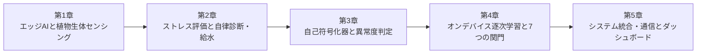
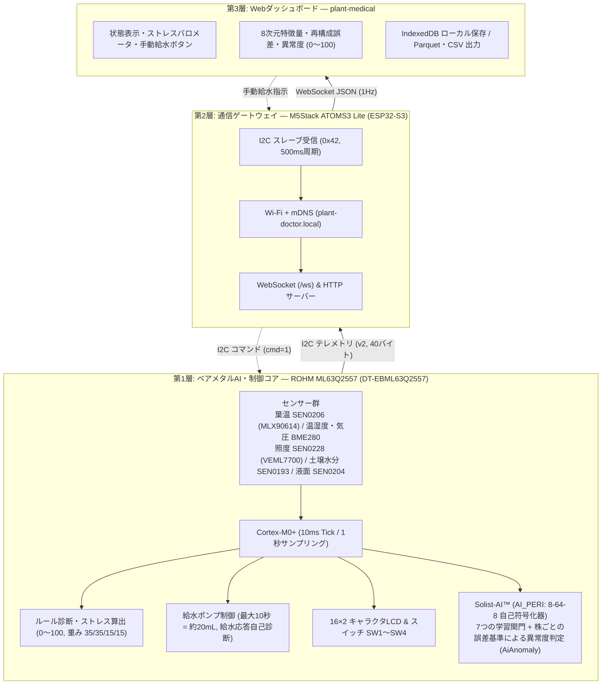

# Plant Doctor 生体AI・オンデバイス学習 解説書

本書は、ROHM のマイコン **ML63Q2557**（DT-EBML63Q2557 ボード）とオンデバイス学習アクセラレータ **Solist-AI™** を使った植物見守りシステム「**Plant Doctor**」の技術解説書です。植物の「いつも」を鉢のそばで覚え、いつもと違う兆候を捉えて水やりと経過観察まで行う仕組みを、ファームウェアのソースコードと設定値、実機の記録にもとづいて詳しく解説します。

従来の自動水やり器は、あらかじめ決めた土壌水分のしきい値だけでポンプを動かしていました。しかし実際の栽培では、植物の種類や鉢の大きさ、土の保水性、窓際か照明下かによって「普段の乾き方」や「葉温の動き」が大きく異なります。Plant Doctor は、ルールによる安全管理（乾燥・熱・水やり失敗の検出と給水）と、Solist-AI による株ごとの「いつも」の学習を組み合わせることで、決定論的な安全性と個別の環境への適応を両立させています。

---

## カリキュラム構成（全5章）

| 章 | タイトル | 主な内容 |
|---|---|---|
| **[第1章](01_edge_ai_and_sensing.md)** | **エッジAIと植物生体センシング技術** | 蒸散と気化熱による葉温・気温差（$\Delta T$）の意味、5種類のセンサー（MLX90614・BME280・VEML7700・SEN0193・SEN0204）の取得処理と単位換算（照度の生値と $0.0576\text{ lx}$ 換算、土壌水分の2点校正）、ボード1枚で完結する3層構成 |
| **[第2章](02_plant_stress_scoring.md)** | **多変量植物ストレス評価と自律診断アルゴリズム** | 4要素（土壌35・熱35・日照15・湿度15）の重みと最大値支配（75%）によるストレスバロメータ（0〜100）、優先順位付きの原因候補推定、自律給水の安全条件と給水後（30秒・3分・5分）の自己診断、30分での給水失敗解除 |
| **[第3章](03_autoencoder_and_anomaly_detection.md)** | **自己符号化器（Autoencoder）と多次元生体異常検知** | 8次元特徴量の設計と `NormalizeToQ8` 正規化（変化速度の履歴15分待機と範囲設定）、8-64-8 自己符号化器の再構成誤差（ppm）、株ごとの平均・ばらつき学習による異常度（0〜100）算出、1回外れても1減らす加減算カウンタによる `WARNING` 判定 |
| **[第4章](04_on_device_learning_mechanism.md)** | **オンデバイス逐次学習（ODL）の数学と7つの関門** | 過去データを保存しない逐次最小二乗法（RLS）と忘却係数 $\lambda = 1.0$、学習フェーズ（Profiling / Stabilizing / Monitoring）、健康なモデルを汚さない7つの関門、給水後1時間半の休止、異常時の間引き（1分に1回）と3時間後の学び直し |
| **[第5章](05_system_integration_and_telemetry.md)** | **システム統合・通信テレメトリと生体コックピット** | I2C バイナリテレメトリ（v2、40バイト、生値照度、異常診断時の異常度85送信）、手動給水経路の統一（`AppStateMachine_RequestManualWatering`）、16×2 LCD 表示とデモモード（SW1長押し・`M=`）、ATOMS3 Lite と Web ダッシュボード `plant-medical` |

---

## システム全体像

Plant Doctor は、センサー取得から AI の学習・推論、ポンプ駆動までを単体で完結させる「マイコン層（ML63Q2557）」、I2C テレメトリを Wi-Fi へ中継する「ゲートウェイ層（ATOMS3 Lite）」、ブラウザで状態と履歴を表示する「ダッシュボード層（plant-medical）」の3層で構成されています。Wi-Fi や PC がつながっていなくても、マイコン基板だけで見守りと給水を続けられます。

---

## 主要仕様（ファームウェア実装値）

| 項目 | 仕様・設定値 |
|---|---|
| **メインMCU** | ROHM ML63Q2557（Arm Cortex-M0+、Flash 256 KB、RAM 16 KB、ベアメタル C 実装） |
| **AIアクセラレータ** | 内蔵ハードウェア `AI_PERI`（Solist-AI™ ライブラリ、3層自己符号化器 8-64-8） |
| **活性化・損失関数** | Sigmoid 活性化関数（`ODL_ACTV_SIGMOID`）、二乗平均誤差（`ODL_LOSS_MSE`）、忘却係数 $\lambda = 1.0$（`0x3F80`） |
| **制御・計測周期** | システム Tick 10 ms（`PLANT_DOCTOR_TICK_MS`）、センサー取得・AI 更新 1.0 秒（100 ticks） |
| **ストレス算出** | 0〜100、重みは土壌 35・熱 35・日照 15・湿度 15、最大値支配度 75% |
| **AI異常度判定** | 健康サンプル 600 件（変化速度履歴 15 分待機後）で基準確立、異常度 50 以上が約 1 分で `WARNING`、30 未満が約 2 分で解除 |
| **学習保護・休止** | 給水後 5400 サンプル（約 1 時間半）は AI 判定・学習を休止。異常時は 60 サンプル（1 分）に 1 回へ間引き、10800 サンプル（3 時間）継続で学び直し |
| **給水制御** | 1 回最大 10.0 秒（約 20 mL）、クールダウン 3.0 秒、自動給水は最小間隔 30 分・1 日最大 6 回、給水失敗は 30 分で解除 |
| **ゲートウェイ通信** | I2C アドレス `0x42`、500 ms 周期、40 バイト固定長パケット（16-bit 加算チェックサム付き） |

まずは **[第1章 エッジAIと植物生体センシング技術](01_edge_ai_and_sensing.md)** から読み進めてください。
